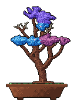

<h1 align="center">Hi 👋, I'm Yash Ladekar</h1>
<h3 align="center">Still a learner — always looking forward to learning new things</h3>

<picture>
  
</picture>

<picture>
  
</picture>
<picture>
  
</picture>

 
<a href="https://github.com/yashladekar#year-list-container">
  <picture>
    <source media="(prefers-color-scheme: dark)" srcset="cards/stats-dark.svg">
    
  </picture>
</a>
<a href="https://github.com/yashladekar?tab=repositories">
  <picture>
    <source media="(prefers-color-scheme: dark)" srcset="cards/languages-dark.svg">
    
  </picture>
</a>
 

<h3 align="left">Languages and Tools:</h3>

  
  
  
  
  
  
  
  
  
  

